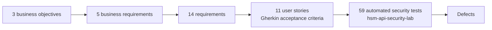

# Requirements Traceability

[](https://github.com/artysficial/requirements-traceability/actions/workflows/tests.yml)
[](https://artysficial.github.io/requirements-traceability/)

The IT Business Analyst lens on the fictional **Arunika Bank payment-security programme**: a Business Requirement
Document traced all the way from business objectives to **live automated test evidence**.

**[View the live dashboard →](https://artysficial.github.io/requirements-traceability/)** · **[Read the BRD →](docs/BRD.md)**



## What makes it live

The dashboard does not hold copied results. On every run it downloads the latest `results.json` published by
[hsm-api-security-lab](https://github.com/artysficial/hsm-api-security-lab), so a requirement turns
**Verified** or **Failing** as soon as the security suite changes. If the site is unreachable, a committed snapshot
is used and the dashboard says so.

## Baseline quality gates (pytest)

- unique ids; every requirement traces up to a business requirement and an objective; no business requirement
  left undecomposed; MoSCoW priorities
- stories follow *As a… I want… so that…*; every story has Given/When/Then acceptance criteria; Fibonacci points
- every *Must* requirement has a story and automated tests; no orphan references; every failing requirement has a
  logged defect
- the matrix status rules themselves (verified, failing, partial, untested, not covered)

The story-template gate caught one of my own stories ("As card operations, I want…") while this was built.

```bash
pip install -r requirements.txt
python -m pytest && python tools/build_dashboard.py
```

Built by [Rahmadani Tyas Ningrum](https://artysficial.github.io/) · MIT licence
