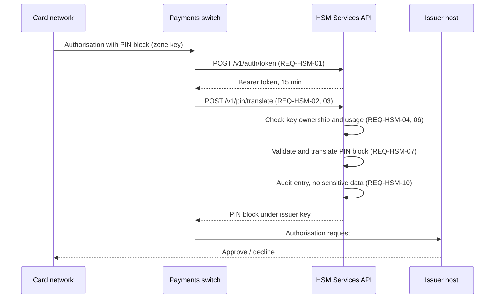

# Business Requirement Document: HSM Services API

| | |
| --- | --- |
| **Organisation** | Arunika Bank (fictional) |
| **Programme** | Payment Security Modernisation |
| **Version** | 1.2 (baseline for build) |
| **Author** | Rahmadani Tyas Ningrum, IT Business Analyst |
| **Approvers** | Head of Payments Technology, CISO, Head of Card Operations, Head of Internal Audit |

## 1. Background

Card payments, mobile banking and the payments switch each connect to the bank's payment HSMs directly, with
their own keys, credentials and logging. The 2026 IT maturity assessment rated key management and security
operations at level 2 of 5 and flagged the direct links as the main obstacle to passing the 2027 PCI PIN Security
assessment. The programme puts one secure, audited **HSM Services API** in front of the HSMs.

## 2. Business objectives

| ID | Objective | Measure |
| --- | --- | --- |
| BO-01 | Pass the 2027 PCI PIN Security assessment with no major findings | assessor report |
| BO-02 | Let digital channels use HSM services through one secure API | 100 % of channels migrated by Q1 2027 |
| BO-03 | Cut key-management incidents by 50 % | incident register, 12-month comparison |

## 3. Scope

**In scope:** client authentication and authorisation, key generation and metadata, PIN translation (ISO-0, ISO-4),
MAC generation and verification, audit logging, rate limiting, transport hardening.
**Out of scope:** HSM hardware procurement (see the procure-to-pay analytics), key ceremonies (operational
procedure), card personalisation.

## 4. Stakeholders

| Stakeholder | Interest | Involvement |
| --- | --- | --- |
| Head of Payments Technology | delivery, channel migration | owner of BR-01 |
| CISO | key protection, attack resistance | owner of BR-02, BR-05 |
| Head of Card Operations | PIN and MAC services for card traffic | owner of BR-03 |
| Head of Internal Audit | traceability for audit and investigation | owner of BR-04 |
| QA / SDET | testability of every requirement | reviews acceptance criteria |

## 5. Business requirements

| ID | Business requirement | Objective |
| --- | --- | --- |
| BR-01 | Only authorised banking systems can use HSM services | BO-02 |
| BR-02 | Cryptographic keys are protected and used only for their purpose | BO-01 |
| BR-03 | Card payments can translate PINs and verify message integrity through the API | BO-02 |
| BR-04 | Every sensitive action is traceable for audit and investigation | BO-03 |
| BR-05 | The service resists abuse, misuse and common attacks | BO-01 |

## 6. Detailed requirements

Detailed requirements REQ-HSM-01 to REQ-HSM-14, with type and MoSCoW priority, are maintained in
[`data/requirements.json`](../data/requirements.json) and shown with their status on the
[traceability dashboard](https://artysficial.github.io/requirements-traceability/). User stories and Gherkin
acceptance criteria are in [`data/stories.json`](../data/stories.json).

## 7. To-be process: PIN translation

## 8. Assumptions and constraints

- The HSMs support the required key types and PIN block formats (confirmed with the vendor).
- Channels can adopt OAuth 2.0 client credentials by Q4 2026.
- PCI PIN requirements and bank standards take precedence over convenience features.

## 9. Acceptance

A requirement is **verified** when every linked automated test passes in the HSM security suite. Failing
requirements must have a logged defect with an owner. Baseline sign-off requires all *Must* requirements verified.
